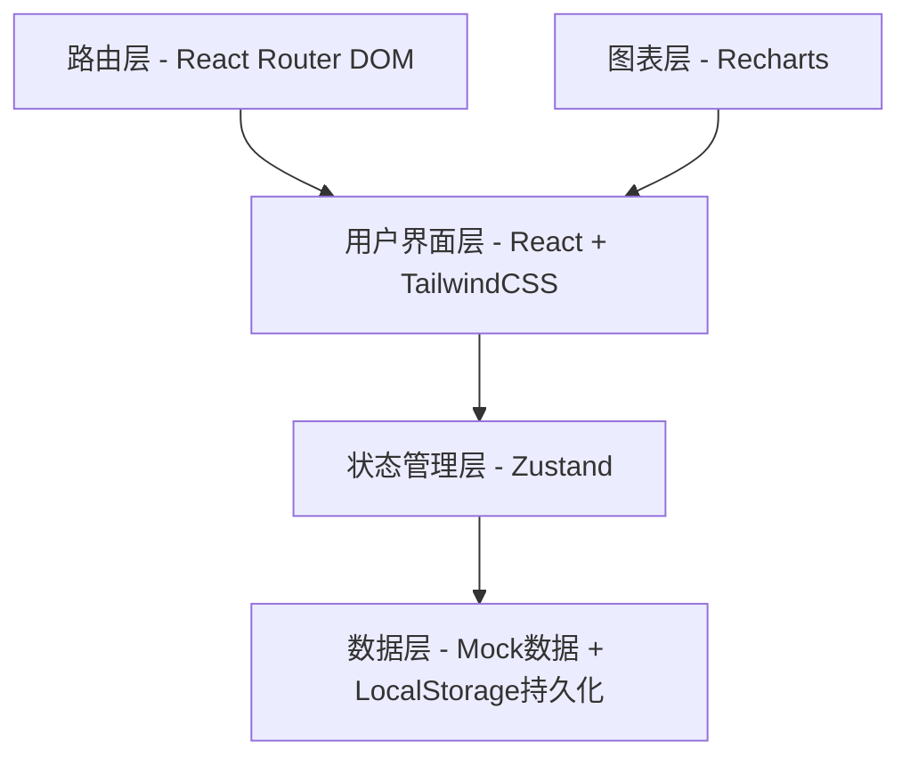

# 个人记账本App - 技术架构文档

## 1. 架构设计



## 2. 技术选型

| 层级 | 技术 | 版本 | 用途 |
|-----|------|------|------|
| 前端框架 | React | 18 | UI组件化开发 |
| 语言 | TypeScript | 5 | 类型安全 |
| 构建工具 | Vite | 5 | 快速构建与热更新 |
| 样式方案 | TailwindCSS | 3 | 原子化CSS |
| 状态管理 | Zustand | 4 | 轻量全局状态 |
| 路由 | React Router DOM | 6 | 单页应用路由 |
| 图表库 | Recharts | 2 | 柱状图、环形饼图 |
| 图标 | lucide-react | latest | 统一线性图标 |
| 日期处理 | date-fns | 3 | 日历计算、日期格式化 |
| 存储 | LocalStorage | - | 前端数据持久化 |

## 3. 路由定义

| 路由 | 页面组件 | 用途 |
|-----|---------|------|
| / | Home.tsx | 首页账本流水，收支概览 |
| /calendar | Calendar.tsx | 日历视图与日期账单 |
| /accounts | Accounts.tsx | 账户管理与净资产 |
| /assets | Assets.tsx | 实物资产管理 |
| /statistics | Statistics.tsx | 收支统计与图表分析 |
| /profile | Profile.tsx | 个人中心 |

## 4. 项目结构

```
src/
  components/              # 公共组件
    BottomNav.tsx          # 底部Tab导航（6个Tab）
    FloatingButton.tsx     # 右下角悬浮记账按钮
    GradientHeader.tsx     # 蓝色渐变头部卡片（复用）
    PageWrapper.tsx        # 页面包装器（滚动、安全区）
    TransactionItem.tsx    # 账单记录行组件
    AccountCard.tsx        # 快捷功能卡片（报销/债务/理财）
    AssetCard.tsx          # 资产网格卡片
    CategoryBar.tsx        # 分类排行进度条
  pages/                   # 页面组件
    Home.tsx               # 首页：账本选择+概览+流水
    Calendar.tsx           # 日历页：月历+今日账单
    Accounts.tsx           # 账户页：净资产+账户列表
    Assets.tsx             # 资产页：总览+筛选+网格
    Statistics.tsx         # 统计页：Tab切换+图表+排行
    Profile.tsx            # 我的页：个人中心
  stores/                  # Zustand状态存储
    useTransactionStore.ts # 账单数据CRUD与汇总计算
    useAccountStore.ts     # 账户数据与分类
    useAssetStore.ts       # 资产数据与筛选
    useUIStore.ts          # UI状态（当前Tab、选中日期等）
  utils/                   # 工具函数
    dateUtils.ts           # 日历生成、农历映射（简化）
    formatters.ts          # 金额格式化（¥xxx,xxx.xx）
    calculations.ts        # 收支汇总、百分比计算
  data/                    # 静态数据
    mockData.ts            # 初始模拟数据（匹配截图）
    categoryConfig.ts      # 分类配置（图标、颜色、层级）
  types/                   # TypeScript类型
    index.ts               # 全局类型定义
  App.tsx                  # 根组件（路由+布局）
  main.tsx                 # 应用入口
```

## 5. 数据模型

### 5.1 TypeScript类型定义

```typescript
// types/index.ts

export type TransactionType = 'income' | 'expense';
export type AccountType = 'fund' | 'recharge' | 'credit' | 'investment' | 'other';
export type AssetStatus = 'active' | 'retired' | 'sold';

export interface Transaction {
  id: string;
  type: TransactionType;
  amount: number;
  category: string;
  subcategory: string;
  account: string;
  date: string; // YYYY-MM-DD
  note: string;
}

export interface Account {
  id: string;
  name: string;
  type: AccountType;
  balance: number;
}

export interface Asset {
  id: string;
  name: string;
  category: string;
  price: number;
  days: number;
  dailyCost: number;
  status: AssetStatus;
}

export interface DayCell {
  date: number;
  fullDate: string;
  lunar: string;
  isCurrentMonth: boolean;
  isToday: boolean;
  isSelected: boolean;
  hasTransaction: boolean;
}

export interface CategoryStat {
  name: string;
  amount: number;
  count: number;
  percentage: number;
  color: string;
  icon: string;
}

export interface MonthlySummary {
  income: number;
  expense: number;
  balance: number;
}
```

## 6. 关键实现方案

### 6.1 日历实现
- 使用 `date-fns` 的 `startOfMonth`、`endOfMonth`、`eachDayOfInterval`、`getDay` 生成月历网格
- 农历显示采用简化预映射表（覆盖常见日期），非精确农历库
- 点击日期时更新 `useUIStore` 的 `selectedDate`，并筛选该日 `transactions`
- 今日按钮调用 `new Date()` 重置选中日期并刷新视图

### 6.2 图表实现（Recharts）
- **柱状图**：使用 `BarChart` + `Bar` + `XAxis` + `YAxis` + `Tooltip`
  - 数据按日期聚合（1-31日）
  - 柱子颜色：`#43A047`（支出）/ `#E53935`（收入）/ `#4A90D9`（结余）
  - Y轴刻度格式化（0 → 0.00, 1000 → 1.0k）
- **环形饼图**：使用 `PieChart` + `Pie`（`innerRadius` 设为外径60%形成donut）
  - 数据按一级分类聚合
  - 图例使用自定义渲染，左右分布
  - 颜色映射：`#5B9BD5`、 `#E57373`、 `#FFB74D`、 `#81C784`、 `#9575CD`、 `#4DD0E1`、 `#FF8A65`

### 6.3 数据持久化
- Zustand store 创建时从 `localStorage` 读取初始数据
- 每个 store 的 `subscribe` 监听状态变化，同步写入 `localStorage`
- 首次无数据时使用 `mockData.ts` 中的模拟数据初始化
- 数据变更操作（增删改账单、账户、资产）自动触发持久化

### 6.4 记账弹窗
- 首页和日历页的悬浮+按钮触发全屏/底部滑出弹窗
- 弹窗内步骤：选择类型（收入/支出）→ 选择分类 → 选择账户 → 输入金额 → 确认
- 使用 `useUIStore` 管理弹窗显隐状态

### 6.5 金额显示规范
- 使用 `Intl.NumberFormat('zh-CN', { style: 'currency', currency: 'CNY' })` 格式化
- 隐藏金额时显示 `****`
- 收支金额带符号：`+` 红色（收入）、`-` 绿色（支出）

## 7. 性能考虑

- 账单列表使用虚拟滚动（如数据量大时）
- 图表数据在月份切换时重新聚合计算
- Zustand 状态拆分避免不必要的重渲染
- 图片资源使用 CSS/SVG 占位符替代真实图片
